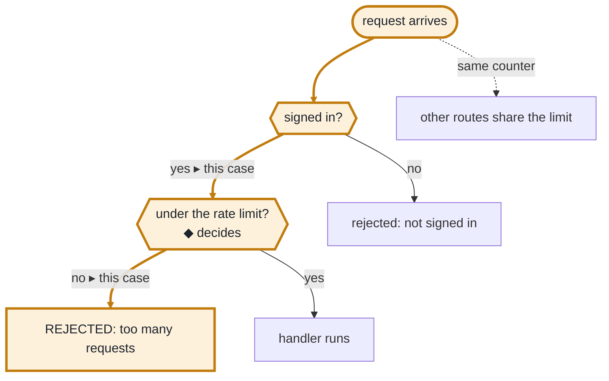
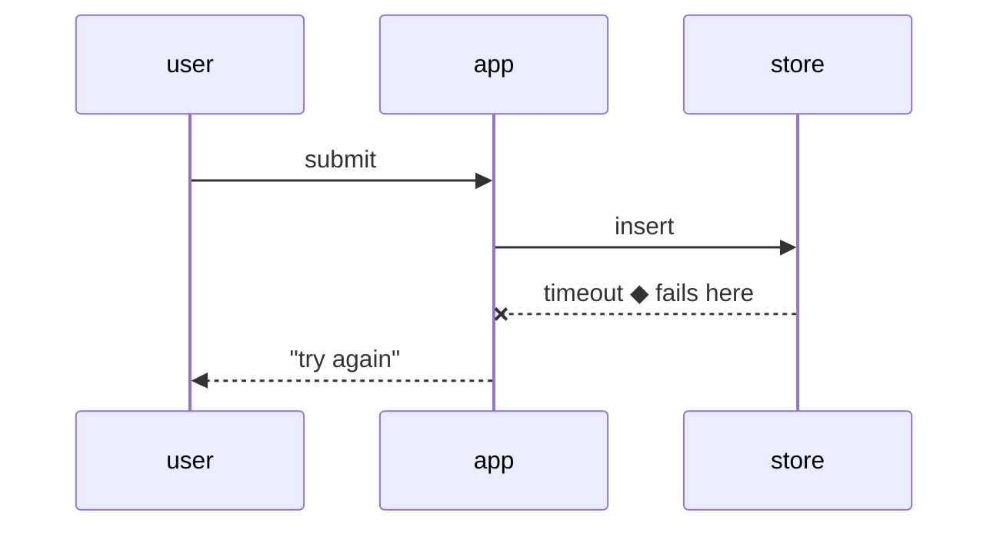
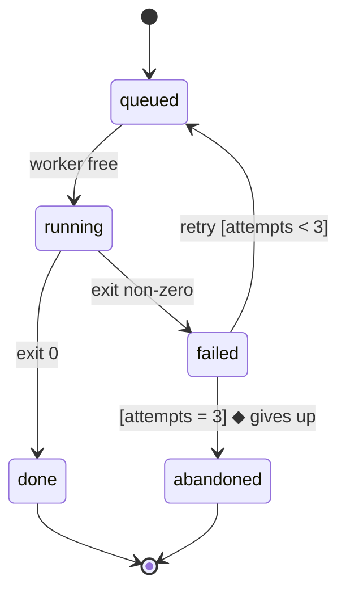

# Forms

The reference half of [`graph-it`](SKILL.md): one recipe per form, as text and as HTML where the form has a page shape. Every example uses invented names and values. In the HTML recipes, `path:line` is a [cite](#cite).

## Control flow

Shows: the decisions a case passes through and the exit it took.

**Text.** Mermaid where the surface renders it; otherwise the exits as an indented list. At most eight nodes, each label at most two short lines in plain words; setting names, defaults and thresholds go in a table under the diagram. A flow that needs more nodes is a [zoom set](#zoom-set). A decision is a question in a hexagon (`{{…}}`), which stays far shorter than Mermaid's diamond for the same label; each exit is labelled with its branch value; each end names its outcome. Every node and edge on the case's path is coloured (`classDef`, `linkStyle`), its exits say `▸ this case`, and the deciding node says `◆ decides`. `linkStyle` counts edges in the order they are written, so write the case's path first and colour indices `0` to `n−1`. A second finding off the main path is a dotted edge (`-.->`).



Text-only form of the same flow:

```
request arrives
  signed in?              no → rejected: not signed in
  ▸ yes
  under the rate limit?   ◆ decides
  ▸ no → REJECTED: too many requests
    yes → handler runs
  (other routes share the same counter)
```

**HTML.** The same Mermaid source in `<pre class="mermaid">`, drawn on the page by two script tags at the end of `<body>`: the vendored Mermaid file, then its `initialize` call. **Find or create the vendored copy** before the first page: reuse a `mermaid-<version>.min.js` already kept beside other pages in the same directory; otherwise fetch the pinned release tarball once from the npm registry (`mermaid-<version>.tgz`), compare its sha512 with the registry's `dist.integrity`, copy `dist/mermaid.min.js` beside the page as `mermaid-<version>.min.js`, and write the version and checksum next to it. A private page loads nothing remote, so the copy is the only way the diagram appears. Under the diagram, one legend line names the colour; on a phone it also says the diagram scrolls, and the diagram keeps a legible width inside a box that scrolls sideways.

```html
<div class="flow"><pre class="mermaid">flowchart TD
  …</pre></div>
<p class="legend">Orange: the path this case took.<span class="narrow"> Scroll the diagram sideways.</span></p>
…
<script src="mermaid-12.2.0.min.js"></script>
<script>
var dark = matchMedia('(prefers-color-scheme: dark)').matches;
mermaid.initialize({ startOnLoad: true, securityLevel: 'strict', theme: dark ? 'dark' : 'default',
  themeVariables: { fontSize: '15px' },
  flowchart: { useMaxWidth: false, wrappingWidth: 320, nodeSpacing: 28, rankSpacing: 32, padding: 8 } });
</script>
```

```css
.flow { background: var(--panel); border: 1px solid var(--rule); border-radius: 8px; padding: 8px; overflow-x: auto; }
.flow svg { display: block; margin: 0 auto; height: auto; }
.legend { font-size: .82rem; color: var(--muted); margin: 4px 0 0; }
.legend .narrow { display: none; }
@media (max-width: 600px) {
  .flow svg { max-width: none; }
  .legend .narrow { display: inline; }
}
```

### Zoom set

A flow that needs more than eight nodes (a complete mechanism, "the whole path") is drawn as a zoom set: an overview of its stages, one diagram per stage, and the whole diagram kept collapsed below them.

- **Cut** at the hand-offs, the nodes every path still running passes through. Where paths run side by side, cut where they reconverge, and keep a branch that never reconverges wholly inside the stage that holds its branch point. The stages then form a chain, and the only edges between two diagrams run through stubs. An end that two stages reach is drawn in both.
- **Overview.** Three to seven stages named in plain words, as a row of linked boxes, each in its stage colour, a hand-off phrase on each arrow. The case's path: the hand-offs it crossed are bold orange, the stages it never reached are dashed, and the stage holding the deciding node says `◆ decides`. The row is the navigation, so it works with no script, by keyboard and in a sandboxed frame.
- **Stage.** One control-flow diagram, eight nodes counting its stubs. It starts at a stub `from <n> · <previous stage>` and ends at stubs `to <n> · <next stage>`, each stub in that neighbour's colour, and the case's path coloured as in a single diagram. It sits in a frame of its own colour, with a numbered heading, its settings table under it, and a line of links: overview, previous stage, next stage. Rendered, it fits the 760 px column at desktop width and is at most 1000 px tall; past either, split the stage or shorten its labels. On a phone its box scrolls sideways, as a single diagram's does.
- **The whole diagram** goes in a closed `<details>`, in a box that scrolls, with a zoom bar: fit width, 100%, −, +. Without script the box still scrolls.
- **Stage colours.** Mermaid's `classDef` takes literal colours only (a `var()` is a parse error), so each stage has one pair that reads in both schemes, as the case's orange does, and the `classDef` lines repeat the page's pairs.
- **Stub links.** A stub may also carry `click <id> href "#stage-<n>"`. Mermaid's documentation disables clicks under `securityLevel: 'strict'` (12.2.0 still follows an `href`), so the boxes and links stay the navigation and a stub link is a bonus.

**Text.** The overview on one line, `1 Arrives → accepted → 2 Checked ◆ decides → clean → 3 Stored`, then each stage as its own diagram under its number.

**HTML.** In this example the case stops at the deciding node in stage 2, so stages 3 and 4 are dashed.

```html
<ol class="stages" id="overview" aria-label="Stages, in order">
  <li class="on"><a class="stage-box s1" href="#stage-1">1 · Arrives</a></li>
  <li class="on"><span class="handoff">accepted →</span><a class="stage-box s2" href="#stage-2">2 · Checked <b>◆ decides</b></a></li>
  <li><span class="handoff">clean →</span><a class="stage-box s3" href="#stage-3">3 · Stored</a></li>
  <li><span class="handoff">saved →</span><a class="stage-box s4" href="#stage-4">4 · Shared</a></li>
</ol>
<p class="legend">Orange: the path this case took; dashed: stages it never reached. Each box opens its stage below.</p>

<section class="stage s2" id="stage-2">
<h3><span class="num">2</span> Checked</h3>
<div class="flow"><pre class="mermaid">flowchart TD
  P(["from 1 · Arrives"]) ==> T{{"a file type<br>we accept?"}}
  T == "yes ▸ this case" ==> V{{"virus scan clean?<br>◆ decides"}}
  V == "no ▸ this case" ==> Q["QUARANTINED:<br>the owner is told"]
  T -- no --> R["rejected: wrong type"]
  V -- yes --> N(["to 3 · Stored"])
  click P href "#stage-1"
  click N href "#stage-3"
  classDef hit fill:#fdf1dc,stroke:#c27c0e,stroke-width:3px,color:#1d232b
  classDef s1 fill:#e8ecfb,stroke:#3554d1,stroke-width:2px,color:#1d232b
  classDef s3 fill:#efe7fd,stroke:#7c3aed,stroke-width:2px,color:#1d232b
  class T,V,Q hit
  class P s1
  class N s3
  linkStyle 0,1,2 stroke:#c27c0e,stroke-width:3px</pre></div>
<!-- the settings table -->
<p class="stage-nav"><a href="#overview">overview ↑</a> · <a href="#stage-1">← Arrives</a> · <a href="#stage-3">Stored →</a></p>
</section>
<!-- stages 1, 3 and 4 alike -->

<details class="zoom">
<summary>The whole path in one diagram</summary>
<div class="zoom-bar" role="toolbar" aria-label="Zoom"><button type="button" data-zoom="fit">Fit width</button>
  <button type="button" data-zoom="1">100%</button><button type="button" data-zoom="out" aria-label="Zoom out">−</button>
  <button type="button" data-zoom="in" aria-label="Zoom in">+</button><output>100%</output></div>
<div class="zoom-box" tabindex="0" role="region" aria-label="The whole path, scrollable"><pre class="mermaid">flowchart TD
  …</pre></div>
</details>
```

The zoom script is its own `<script>` after the `initialize` call, so it runs even when the diagrams fail to draw:

```html
<script>
document.querySelectorAll('.zoom').forEach(function (z) {
  var box = z.querySelector('.zoom-box'), out = z.querySelector('output'), k = 1;
  z.querySelector('.zoom-bar').addEventListener('click', function (e) {
    var a = e.target.getAttribute('data-zoom'), s = box.querySelector('svg');
    if (!a || !s) return;
    var v = s.viewBox.baseVal;
    k = a === 'fit' ? (box.clientWidth - 16) / v.width : a === 'in' ? k * 1.25 : a === 'out' ? k / 1.25 : 1;
    k = Math.min(4, Math.max(0.1, k));
    s.style.width = v.width * k + 'px'; s.style.height = v.height * k + 'px';
    out.textContent = Math.round(k * 100) + '%';
  });
});
</script>
```

```css
.s1 { --stage: #3554d1; --stage-bg: #e8ecfb; }
.s2 { --stage: #0f7b6c; --stage-bg: #def3ee; }
.s3 { --stage: #7c3aed; --stage-bg: #efe7fd; }
.s4 { --stage: #b4236a; --stage-bg: #fbe6f0; }
.s5 { --stage: #4d7c0f; --stage-bg: #ebf4dd; }
.s6 { --stage: #475569; --stage-bg: #eceef1; }
.s7 { --stage: #0e7490; --stage-bg: #dff1f6; }
.stages { display: flex; flex-wrap: wrap; align-items: center; gap: 8px 0; list-style: none; padding: 0; margin: 8px 0; }
.stages li { display: flex; align-items: center; }
.stages .handoff { font-size: .75rem; color: var(--muted); margin: 0 6px; }
.stages li.on .handoff { color: var(--warn); font-weight: 600; }
.stage-box { color: #1d232b; background: var(--stage-bg); border: 2px solid var(--stage); border-radius: 8px; padding: 4px 10px; text-decoration: none; }
.stages li:not(.on) .stage-box { border-style: dashed; }
.stage { border-left: 4px solid var(--stage); padding-left: 10px; margin: 18px 0; }
.stage h3 { color: #1d232b; background: var(--stage-bg); border-radius: 6px; padding: 2px 8px; margin: 0 0 6px; }
.stage .num { display: inline-block; min-width: 1.5em; text-align: center; color: #fff; background: var(--stage); border-radius: 999px; }
.stage-nav { font-size: .85rem; margin: 4px 0 0; }
.stage-nav a { color: var(--accent); }
.zoom-bar { display: flex; gap: 6px; align-items: center; margin: 6px 0; }
.zoom-bar button { font: inherit; color: var(--ink); background: var(--panel); border: 1px solid var(--rule); border-radius: 6px; padding: 2px 10px; }
.zoom-box { max-height: 80vh; overflow: auto; background: var(--panel); border: 1px solid var(--rule); border-radius: 8px; padding: 8px; }
.zoom-box svg { display: block; max-width: none; }
```

## Pseudocode

Shows: the exact rule, with the case's own numbers beside it.

**Text.** One line per decision, at most eight lines. Indentation is nesting, `->` is an outcome. Constants are named, and their values and the source cite sit in a comment on the first line. The case's value is a comment on the line that computes it; the deciding line ends in `◆ decides`. A line with its comment stays under 40 characters, so a phone shows it without wrapping.

```
// gate.ts:40  LIMIT = 100 (env)
admit(request)
  if not valid(token)  -> 401
  n = window.count(client, 60s)  // 104
  if n >= LIMIT  -> 429  ◆ decides
  -> handler(request)
```

**HTML.** `<pre>`, the deciding line in `<mark>`, comments in `<span class="cmt">`, the cite a chip.

```html
<pre><span class="cmt">// <a class="cite" href="…">gate.ts:40</a>  LIMIT = 100 (env)</span>
admit(request)
  if not valid(token)  -&gt; 401
  n = window.count(client, 60s)  <span class="cmt">// 104</span>
<mark>  if n &gt;= LIMIT  -&gt; 429  ◆ decides</mark>
  -&gt; handler(request)</pre>
```

```css
pre mark { background: var(--warn-bg); color: inherit; }
pre .cmt { color: var(--muted); }
```

## Types and data models

Shows: the shape of what crosses a boundary, or the fields a rule reads.

**Text.** Names and types, details elided with `// …`. The fields the question is about stay; the rest is one elision. A contract between two sides is the signature line. The same 40-character line bound as pseudocode; a long signature breaks after the opening parenthesis.

```
// gate.ts:12
interface Request {
  client: ClientId
  token: Token   // …
}
window.count(
  client: ClientId, span: Seconds
) -> number  ◆ reads
```

**HTML.** The same text in `<pre>`, the lines the rule reads in `<mark>`, the cite a chip in a `.cmt` comment on the first line; the pseudocode CSS covers it.

## Diff on a structure

Shows: what changed, on the unchanged structure as context. Works on trees, call stacks, layouts, types and pseudocode alike.

```
 admit(request)
   if not valid(token)   -> 401
+  if burst(client)      -> 429
   n = window.count(client, 60s)
-  if n >= LIMIT         -> 429
+  if n >= limitFor(client) -> 429
```

**HTML.** `<pre class="diff">` with each `+` line wrapped in `<span class="add">` and each `−` line in `<span class="del">`.

```css
.diff .add { background: var(--good-bg); }
.diff .del { background: var(--bad-bg); }
```

## Call stack

Shows: who calls whom, callee indented under caller, in call order. Elide with `…`; mark the step the question is about.

```
handleOrder
  validate
  store.insert
  publish(order.created)
    Worker.run
      …
      callModel          ◆ slow step
      persist
```

## Sequence diagram

Shows: who talks to whom, in what order. Five participants or fewer; the answer point is on the message the question is about.



Text-only form: one line per message, `from → to: message`, the answer point marked `◆`.

## State diagram

Shows: the states, the events that move between them, the guards. Draw the failure states and the exits.



Text-only form: one line per transition, `state —event [guard]→ state`.

## Tree and layout

Shows: what contains what (a component tree, a path per node), or where things live (a shallow file layout, one line of responsibility per entry).

```
src/
├── commands/        # parses user actions into intents
├── sessions/        # owns session state and lifecycle
│   └── store.ts     # insert / list / open   ◆ lives here
└── transport/       # talks to the API, knows nothing about sessions
```

## Gauge

Shows: how a value sits against a threshold, one dot per observation, so variance shows.

**HTML only.** A two-column grid: the row label as text, the dots positioned by `left: <value>%` on a track with the threshold dashed and an axis row (0, threshold, max) under it. The container is `role="group"` with an `aria-label`; each row carries its values in words for screen readers. Dot classes are named by outcome (`.right` / `.wrong`), since which side of the threshold is good depends on the rule.

```html
<div class="gauge" role="group" aria-label="Score per variant against a threshold of 0.5">
  <div>Case, two repeats</div>
  <div><div class="track"><span class="tau" style="left:50%"></span>
    <i class="wrong" style="left:40%"></i><i class="right" style="left:55%"></i></div>
    <span class="sr">0.40 wrong · 0.55 right</span></div>
  <div></div>
  <div class="track-axis"><span>0</span><span>threshold 0.5</span><span>1</span></div>
</div>
```

```css
.gauge { display: grid; grid-template-columns: minmax(110px, 36%) 1fr; gap: 2px 10px; align-items: center; font-size: .82rem; }
.track { position: relative; height: 20px; margin: 0 8px; background: linear-gradient(var(--rule), var(--rule)) center / 100% 1px no-repeat; }
.track .tau { position: absolute; top: 0; bottom: 0; border-left: 1px dashed var(--accent); }
.track i { position: absolute; top: 50%; width: 11px; height: 11px; margin: -5.5px 0 0 -5.5px; border-radius: 50%; }
.track i.right { background: var(--good); }
.track i.wrong { background: var(--panel); border: 2.5px solid var(--bad); }
.track-axis { display: flex; justify-content: space-between; margin: 0 8px; font-size: .75rem; color: var(--muted); }
.sr { position: absolute; width: 1px; height: 1px; overflow: hidden; clip: rect(0 0 0 0); }
```

## Table

Shows: rows that differ in one or two columns (variants against a case, options against the same criteria). Sort it so the rows the reader will compare sit next to each other; tint the rows that go wrong.

**HTML.** Cells carry `data-label` naming their column, so that on a phone each row becomes a block of labelled lines with the header row hidden from sight.

```css
table { border-collapse: collapse; width: 100%; }
th, td { text-align: left; padding: 6px 8px; border-bottom: 1px solid var(--rule); vertical-align: top; }
@media (max-width: 600px) {
  thead { position: absolute; width: 1px; height: 1px; overflow: hidden; clip: rect(0 0 0 0); }
  tr { display: block; padding: 6px 0; border-bottom: 1px solid var(--rule); }
  td { display: block; border: 0; padding: 2px 8px; }
  td::before { content: attr(data-label); display: block; font-weight: 600; color: var(--muted); }
}
```

## Numbers and bars

Shows: counts (a number in text, or a count matrix of integers with the row and column that matter marked) and durations (one bar per item on a shared axis with a labelled scale, a now line, a tick per deadline).

## Dependency graph

Shows: what depends on what, as node-link or as an adjacency matrix (the caller chooses by density). Every arrow points from the thing that comes first, whichever side declared the relation; an edge label names the relation in the reader's words.

## Cite

Shows: where a claim was read, as a link that opens the file at that line.

**Text.** `path:12` or `path:12-20`, repo-relative, with the commit named once nearby.

**HTML.** The label stays repo-relative; the link depends on where the page is read.

- **On the machine that holds the checkout** (the default): the reader's editor, by its URL scheme, at the absolute path of the checkout the claim was read from and the first cited line, the path percent-encoded: `zed://file/<abs>:<line>`, `vscode://file/<abs>:<line>`, or that editor's own scheme. The project or the user names the editor; ask once when neither does. The `title` names the commit the line numbers refer to, since the checkout can move on.
- **Off the machine** (a page that is sent, posted or published): the public blob link at the pinned commit.
- **Private material**: text, never a link.

Every cite link opens with `target="_blank" rel="noopener"`, so a page in a frame opens a blob in a new tab instead of inside the frame. A sandboxed frame passes an editor link only when its sandbox grants `allow-popups` or a top-navigation token; checked in Chromium, where the link then reaches the operating system's handler, and without one is blocked.

```html
<a class="cite" href="zed://file/home/me/src/shop/src/gate.ts:12" title="at a1b2c3d" target="_blank" rel="noopener">src/gate.ts:12-20</a>
<a class="cite" href="https://github.com/acme/shop/blob/a1b2c3d/src/gate.ts#L12-L20" target="_blank" rel="noopener">src/gate.ts:12-20</a>
<code class="cite">~/private/run.txt</code>
```
