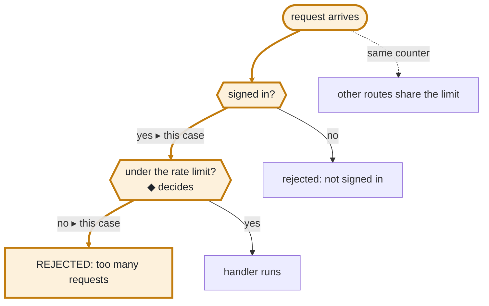
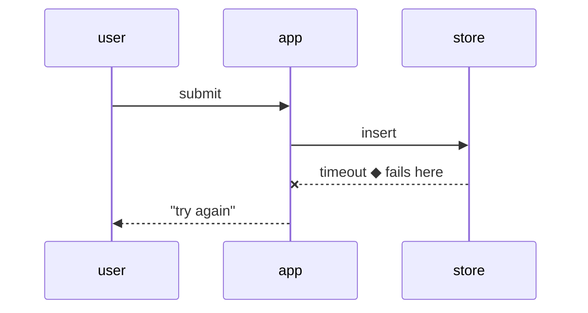
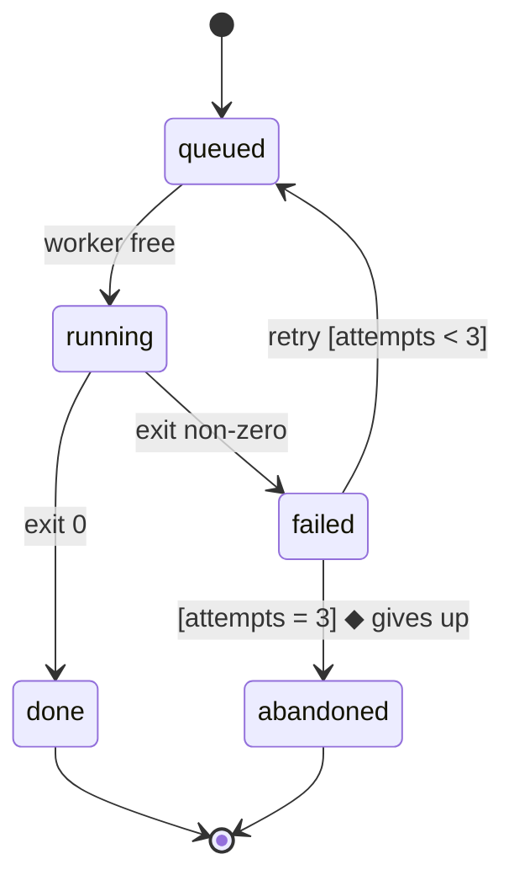

# Forms

The reference half of [`graph-it`](SKILL.md): one recipe per form, as text and as HTML where the form has a page shape. Every example uses invented names and values. In the HTML recipes, `path:line` is a citation chip in the calling page's own chip style.

## Control flow

Shows: the decisions a case passes through and the exit it took.

**Text.** Mermaid where the surface renders it; otherwise the exits as an indented list. At most eight nodes, each label at most two short lines in plain words. A decision is a question in a hexagon (`{{…}}`), which stays far shorter than Mermaid's diamond for the same label; each exit is labelled with its branch value; each end names its outcome. Every node and edge on the case's path is coloured (`classDef`, `linkStyle`), its exits say `▸ this case`, and the deciding node says `◆ decides`. `linkStyle` counts edges in the order they are written, so write the case's path first and colour indices `0` to `n−1`. A second finding off the main path is a dotted edge (`-.->`).



Text-only form of the same flow:

```
request arrives
  signed in?              no → rejected: not signed in
  ▸ yes
  under the rate limit?   ◆ decides
  ▸ no → REJECTED: too many requests
    yes → handler runs
  (other routes share the same counter)
```

**HTML.** The same Mermaid source in `<pre class="mermaid">`, drawn on the page by two script tags at the end of `<body>`: the vendored Mermaid file, then its `initialize` call. **Find or create the vendored copy** before the first page: reuse a `mermaid-<version>.min.js` already kept beside other pages in the same directory; otherwise fetch the pinned release tarball once from the npm registry (`mermaid-<version>.tgz`), compare its checksum with the registry's `shasum`, copy `dist/mermaid.min.js` beside the page as `mermaid-<version>.min.js`, and write the version and checksum next to it. A private page loads nothing remote, so the copy is the only way the diagram appears. Under the diagram, one legend line names the colour; on a phone it also says the diagram scrolls, and the diagram keeps a legible width inside a box that scrolls sideways.

```html
<div class="flow"><pre class="mermaid">flowchart TD
  …</pre></div>
<p class="legend">Orange: the path this case took.<span class="narrow"> Scroll the diagram sideways.</span></p>
…
<script src="mermaid-12.2.0.min.js"></script>
<script>
var dark = matchMedia('(prefers-color-scheme: dark)').matches;
mermaid.initialize({ startOnLoad: true, securityLevel: 'strict', theme: dark ? 'dark' : 'default',
  themeVariables: { fontSize: '15px' },
  flowchart: { useMaxWidth: true, wrappingWidth: 320, nodeSpacing: 28, rankSpacing: 32, padding: 8 } });
</script>
```

```css
.flow { background: var(--panel); border: 1px solid var(--rule); border-radius: 8px; padding: 8px; }
.flow svg { display: block; margin: 0 auto; max-width: 100%; height: auto; }
.legend { font-size: .82rem; color: var(--muted); margin: 4px 0 0; }
.legend .narrow { display: none; }
@media (max-width: 600px) {
  .flow { overflow-x: auto; }
  .flow svg { min-width: 520px; }
  .legend .narrow { display: inline; }
}
```

## Pseudocode

Shows: the exact rule, with the case's own numbers beside it.

**Text.** One line per decision, at most eight lines. Indentation is nesting, `->` is an outcome. Constants are named, and their values and the source cite sit in a comment on the first line. The case's value is a comment on the line that computes it; the deciding line ends in `◆ decides`. A line with its comment stays under 40 characters, so a phone shows it without wrapping.

```
// gate.ts:40  LIMIT = 100 (env)
admit(request)
  if not valid(token)  -> 401
  n = window.count(client, 60s)  // 104
  if n >= LIMIT  -> 429  ◆ decides
  -> handler(request)
```

**HTML.** `<pre>`, the deciding line in `<mark>`, comments in `<span class="cmt">`, the cite a chip.

```html
<pre><span class="cmt">// <a class="cite" href="…">gate.ts:40</a>  LIMIT = 100 (env)</span>
admit(request)
  if not valid(token)  -&gt; 401
  n = window.count(client, 60s)  <span class="cmt">// 104</span>
<mark>  if n &gt;= LIMIT  -&gt; 429  ◆ decides</mark>
  -&gt; handler(request)</pre>
```

```css
pre mark { background: var(--warn-bg); color: inherit; }
pre .cmt { color: var(--muted); }
```

## Types and data models

Shows: the shape of what crosses a boundary, or the fields a rule reads.

**Text.** Names and types, details elided with `// …`. The fields the question is about stay; the rest is one elision. A contract between two sides is the signature line. The same 40-character line bound as pseudocode; a long signature breaks after the opening parenthesis.

```
// gate.ts:12
interface Request {
  client: ClientId
  token: Token   // …
}
window.count(
  client: ClientId, span: Seconds
) -> number  ◆ reads
```

**HTML.** The same text in `<pre>`, the lines the rule reads in `<mark>`, the cite a chip in a `.cmt` comment on the first line; the pseudocode CSS covers it.

## Diff on a structure

Shows: what changed, on the unchanged structure as context. Works on trees, call stacks, layouts, types and pseudocode alike.

```
 admit(request)
   if not valid(token)   -> 401
+  if burst(client)      -> 429
   n = window.count(client, 60s)
-  if n >= LIMIT         -> 429
+  if n >= limitFor(client) -> 429
```

**HTML.** `<pre class="diff">` with each `+` line wrapped in `<span class="add">` and each `−` line in `<span class="del">`.

```css
.diff .add { background: var(--good-bg); }
.diff .del { background: var(--bad-bg); }
```

## Call stack

Shows: who calls whom, callee indented under caller, in call order. Elide with `…`; mark the step the question is about.

```
handleOrder
  validate
  store.insert
  publish(order.created)
    Worker.run
      …
      callModel          ◆ slow step
      persist
```

## Sequence diagram

Shows: who talks to whom, in what order. Five participants or fewer; the answer point is on the message the question is about.



Text-only form: one line per message, `from → to: message`, the answer point marked `◆`.

## State diagram

Shows: the states, the events that move between them, the guards. Draw the failure states and the exits.



Text-only form: one line per transition, `state —event [guard]→ state`.

## Tree and layout

Shows: what contains what (a component tree, a path per node), or where things live (a shallow file layout, one line of responsibility per entry).

```
src/
├── commands/        # parses user actions into intents
├── sessions/        # owns session state and lifecycle
│   └── store.ts     # insert / list / open   ◆ lives here
└── transport/       # talks to the API, knows nothing about sessions
```

## Gauge

Shows: how a value sits against a threshold, one dot per observation, so variance shows.

**HTML only.** A two-column grid: the row label as text, the dots positioned by `left: <value>%` on a track with the threshold dashed and an axis row (0, threshold, max) under it. The container is `role="group"` with an `aria-label`; each row carries its values in words for screen readers. Dot classes are named by outcome (`.right` / `.wrong`), since which side of the threshold is good depends on the rule.

```html
<div class="gauge" role="group" aria-label="Score per variant against a threshold of 0.5">
  <div>Case, two repeats</div>
  <div><div class="track"><span class="tau" style="left:50%"></span>
    <i class="wrong" style="left:40%"></i><i class="right" style="left:55%"></i></div>
    <span class="sr">0.40 wrong · 0.55 right</span></div>
  <div></div>
  <div class="track-axis"><span>0</span><span>threshold 0.5</span><span>1</span></div>
</div>
```

```css
.gauge { display: grid; grid-template-columns: minmax(110px, 36%) 1fr; gap: 2px 10px; align-items: center; font-size: .82rem; }
.track { position: relative; height: 20px; margin: 0 8px; background: linear-gradient(var(--rule), var(--rule)) center / 100% 1px no-repeat; }
.track .tau { position: absolute; top: 0; bottom: 0; border-left: 1px dashed var(--accent); }
.track i { position: absolute; top: 50%; width: 11px; height: 11px; margin: -5.5px 0 0 -5.5px; border-radius: 50%; }
.track i.right { background: var(--good); }
.track i.wrong { background: var(--panel); border: 2.5px solid var(--bad); }
.track-axis { display: flex; justify-content: space-between; margin: 0 8px; font-size: .75rem; color: var(--muted); }
.sr { position: absolute; width: 1px; height: 1px; overflow: hidden; clip: rect(0 0 0 0); }
```

## Table

Shows: rows that differ in one or two columns (variants against a case, options against the same criteria). Sort it so the rows the reader will compare sit next to each other; tint the rows that go wrong.

**HTML.** Cells carry `data-label` naming their column, so that on a phone each row becomes a block of labelled lines with the header row hidden from sight.

```css
table { border-collapse: collapse; width: 100%; }
th, td { text-align: left; padding: 6px 8px; border-bottom: 1px solid var(--rule); vertical-align: top; }
@media (max-width: 600px) {
  thead { position: absolute; width: 1px; height: 1px; overflow: hidden; clip: rect(0 0 0 0); }
  tr { display: block; padding: 6px 0; border-bottom: 1px solid var(--rule); }
  td { display: block; border: 0; padding: 2px 8px; }
  td::before { content: attr(data-label); display: block; font-weight: 600; color: var(--muted); }
}
```

## Numbers and bars

Shows: counts (a number in text, or a count matrix of integers with the row and column that matter marked) and durations (one bar per item on a shared axis with a labelled scale, a now line, a tick per deadline).

## Dependency graph

Shows: what depends on what, as node-link or as an adjacency matrix (the caller chooses by density). Every arrow points from the thing that comes first, whichever side declared the relation; an edge label names the relation in the reader's words.
