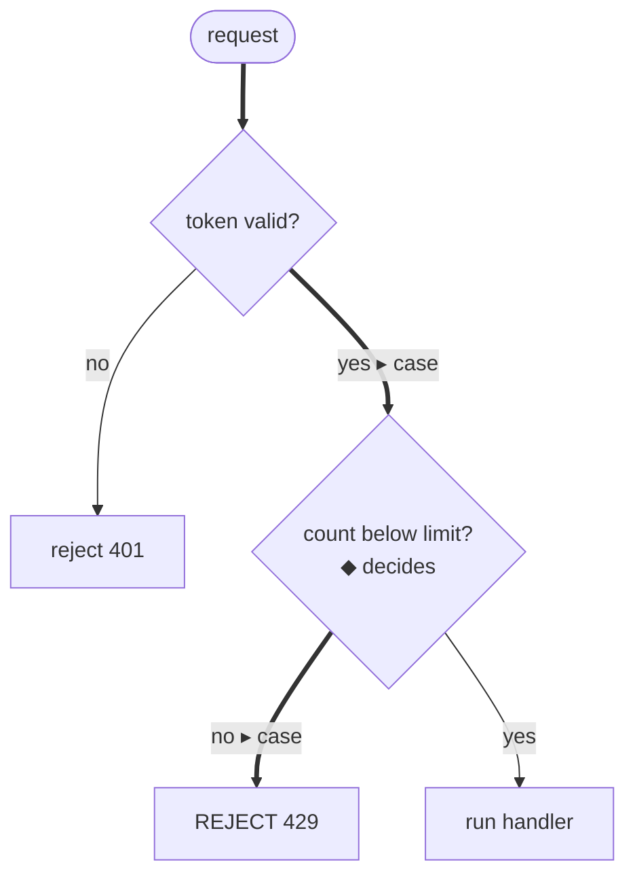
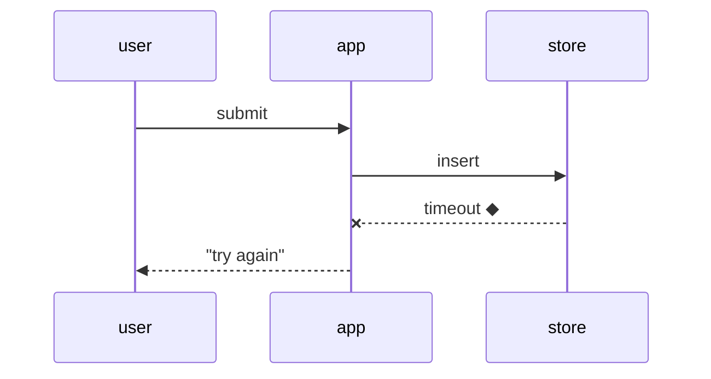
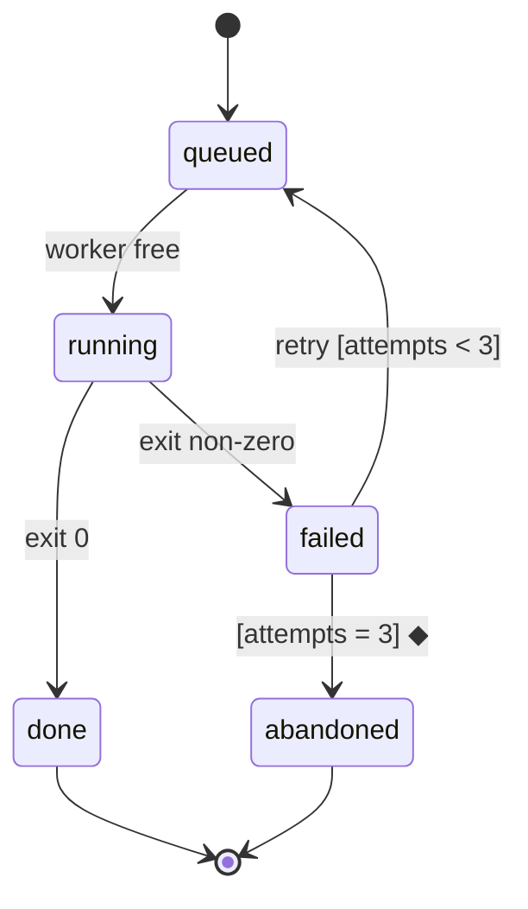

# Forms

The reference half of [`visualizing`](SKILL.md): one recipe per form, as text and as HTML where the form has a page shape. Every example uses invented names and values. In the HTML recipes, `path:line` is a citation chip in the calling page's own chip style.

## Control flow

Shows: the decisions a case passes through and the exit it took.

**Text.** Mermaid where the surface renders it; otherwise the exits as an indented list. At most nine nodes. A decision is a predicate ending in `?`, each exit is labelled with its branch value, each end names its outcome as a word. The taken exits carry `▸ case` and thick edges; the deciding node carries `◆ decides`.



Text-only form of the same flow:

```
request
  token valid?            no → reject 401
  ▸ yes
  count below limit?      ◆ decides
  ▸ no → REJECT 429
    yes → run handler
```

**HTML.** A vertical list of nodes, so labels stay readable on a phone, where a scaled SVG shrinks its text. The on-path nodes carry the accent border, the taken exits `▸ case`, the deciding node `◆ decides`; an off-path node stays plain.

```html
<ol class="flow" aria-label="Control flow; the case's path is marked">
  <li class="node on-path"><b>request arrives</b> <a class="cite" href="…">gate.ts:31</a></li>
  <li class="node on-path"><b>token valid?</b>
    <ul class="exits"><li>no → reject 401</li><li class="taken">▸ case: yes → next</li></ul></li>
  <li class="node on-path decides"><b>count below limit?</b> <span class="tag">◆ decides</span> <a class="cite" href="…">gate.ts:40</a>
    <ul class="exits"><li class="taken">▸ case: no → REJECT 429</li><li>yes → run handler</li></ul></li>
  <li class="node"><b>run handler</b></li>
</ol>
```

```css
.flow { list-style: none; margin: 0; padding: 0 0 0 16px; border-left: 2px solid var(--rule); }
.flow .node { position: relative; margin: 0 0 10px; padding: 8px 10px; border: 1px solid var(--rule); border-radius: 8px; background: var(--panel); }
.flow .node::before { content: ""; position: absolute; left: -23px; top: 14px; width: 8px; height: 8px; border-radius: 50%; background: var(--rule); }
.flow .on-path { border-color: var(--accent); }
.flow .on-path::before { background: var(--accent); }
.flow .decides { border-width: 2px; }
.flow .exits { list-style: none; margin: 4px 0 0; padding: 0; font-size: .9rem; }
.flow .taken { font-weight: 600; }
.flow .tag { font: 12px var(--mono); color: var(--accent); }
```

## Pseudocode

Shows: the exact rule, with the case's own numbers beside it.

**Text.** One line per decision, at most eight lines. Indentation is nesting, `->` is an outcome. Constants are named, and their values and the source cite sit in a comment on the first line. The case's value is a comment on the line that computes it; the deciding line ends in `◆ decides`. A line with its comment stays under 40 characters, so a phone shows it without wrapping.

```
// gate.ts:40  LIMIT = 100 (env)
admit(request)
  if not valid(token)  -> 401
  n = window.count(client, 60s)  // 104
  if n >= LIMIT  -> 429  ◆ decides
  -> handler(request)
```

**HTML.** `<pre>`, the deciding line in `<mark>`, comments in `<span class="cmt">`, the cite a chip.

```html
<pre><span class="cmt">// <a class="cite" href="…">gate.ts:40</a>  LIMIT = 100 (env)</span>
admit(request)
  if not valid(token)  -&gt; 401
  n = window.count(client, 60s)  <span class="cmt">// 104</span>
<mark>  if n &gt;= LIMIT  -&gt; 429  ◆ decides</mark>
  -&gt; handler(request)</pre>
```

```css
pre mark { background: var(--warn-bg); color: inherit; }
pre .cmt { color: var(--muted); }
```

## Types and data models

Shows: the shape of what crosses a boundary, or the fields a rule reads.

**Text.** Names and types, details elided with `// …`. The fields the question is about stay; the rest is one elision. A contract between two sides is the signature line.

```
interface Request {
  client: ClientId
  token: Token
  // …
}
window.count(client: ClientId, span: Seconds) -> number   // ◆ what the rule reads
```

**HTML.** The same text in `<pre>`, the fields the rule reads in `<mark>`, the cite a chip in a `.cmt` comment on the first line.

## Diff on a structure

Shows: what changed, on the unchanged structure as context. Works on trees, call stacks, layouts, types and pseudocode alike.

```
 admit(request)
   if not valid(token)   -> 401
+  if burst(client)      -> 429
   n = window.count(client, 60s)
-  if n >= LIMIT         -> 429
+  if n >= limitFor(client) -> 429
```

**HTML.** `<pre class="diff">` with `+` lines in `.add` and `−` lines in `.del`, tinted by the page's good and bad tokens.

## Call stack

Shows: who calls whom, callee indented under caller, in call order. Elide with `…`; mark the step the question is about.

```
handleOrder
  validate
  store.insert
  publish(order.created)
    Worker.run
      …
      callModel          ◆ the slow step
      persist
```

## Sequence diagram

Shows: who talks to whom, in what order. Five participants or fewer; the answer point is on the message the question is about.



Text-only form: one line per message, `from → to: message`, the answer point marked `◆`.

## State diagram

Shows: the states, the events that move between them, the guards. Draw the failure states and the exits.



Text-only form: one line per transition, `state —event [guard]→ state`.

## Tree and layout

Shows: what contains what (a component tree, a path per node), or where things live (a shallow file layout, one line of responsibility per entry).

```
src/
├── commands/        # parses user actions into intents
├── sessions/        # owns session state and lifecycle
│   └── store.ts     # insert / list / open   ◆
└── transport/       # talks to the API, knows nothing about sessions
```

## Gauge

Shows: how a value sits against a threshold, one dot per observation, so variance shows.

**HTML only.** A two-column grid: the row label as text, the dots positioned by `left: <value>%` on a track with the threshold dashed and an axis row (0, threshold, max) under it. The container is `role="group"` with an `aria-label`; each row carries its values in words for screen readers. Dot classes are named by outcome (`.right` / `.wrong`), since which side of the threshold is good depends on the rule.

```html
<div class="gauge" role="group" aria-label="Score per variant against a threshold of 0.5">
  <div>Case, two repeats</div>
  <div><div class="track"><span class="tau" style="left:50%"></span>
    <i class="wrong" style="left:40%"></i><i class="right" style="left:55%"></i></div>
    <span class="sr">0.40 wrong · 0.55 right</span></div>
  <div></div>
  <div class="track-axis"><span>0</span><span>threshold 0.5</span><span>1</span></div>
</div>
```

```css
.gauge { display: grid; grid-template-columns: minmax(110px, 36%) 1fr; gap: 2px 10px; align-items: center; font-size: .82rem; }
.track { position: relative; height: 20px; margin: 0 8px; background: linear-gradient(var(--rule), var(--rule)) center / 100% 1px no-repeat; }
.track .tau { position: absolute; top: 0; bottom: 0; border-left: 1px dashed var(--accent); }
.track i { position: absolute; top: 50%; width: 11px; height: 11px; margin: -5.5px 0 0 -5.5px; border-radius: 50%; }
.track i.right { background: var(--good); }
.track i.wrong { background: var(--panel); border: 2.5px solid var(--bad); }
.track-axis { display: flex; justify-content: space-between; margin: 0 8px; font-size: .75rem; color: var(--muted); }
.sr { position: absolute; width: 1px; height: 1px; overflow: hidden; clip: rect(0 0 0 0); }
```

## Table

Shows: rows that differ in one or two columns (variants against a case, options against the same criteria). Sort it so the rows the reader will compare sit next to each other; tint the rows that go wrong.

**HTML.** Cells carry `data-label` naming their column, so that on a phone each row becomes a block of labelled lines with the header row hidden from sight.

```css
table { border-collapse: collapse; width: 100%; }
th, td { text-align: left; padding: 6px 8px; border-bottom: 1px solid var(--rule); vertical-align: top; }
@media (max-width: 600px) {
  thead { position: absolute; width: 1px; height: 1px; overflow: hidden; clip: rect(0 0 0 0); }
  tr { display: block; padding: 6px 0; border-bottom: 1px solid var(--rule); }
  td { display: block; border: 0; padding: 2px 8px; }
  td::before { content: attr(data-label); display: block; font-weight: 600; color: var(--muted); }
}
```

## Numbers and bars

Shows: counts (a number, or a count matrix of integers) and durations (one bar per item on a shared axis, a now line, a tick per deadline). Position and length are read more accurately than colour, and a count of three is a number: a chart of three adds ink and no precision.

## Dependency graph

Shows: what depends on what. Node-link up to twelve edges; an adjacency matrix beyond, which stays legible at any density and hides paths. Draw every arrow from the thing that comes first, whichever side declared the relation.
