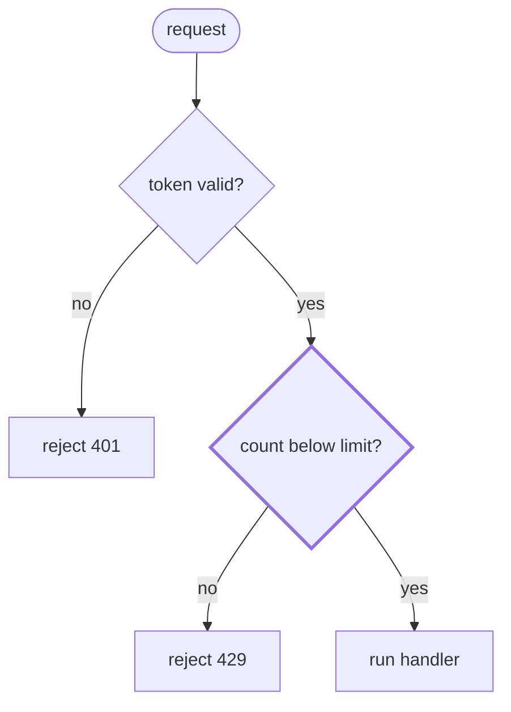
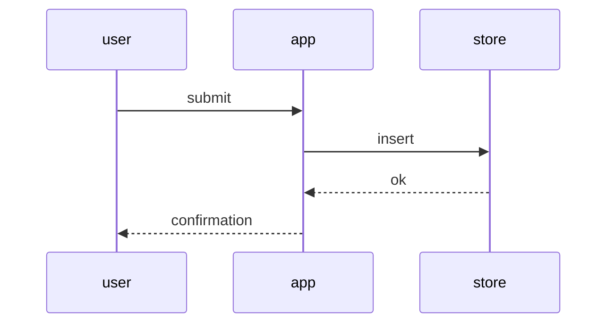
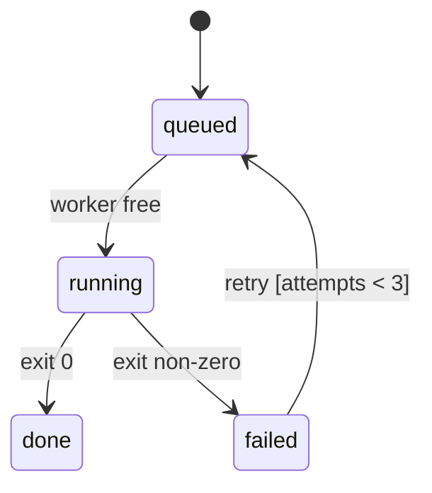

# Forms

The reference half of [`visualizing`](SKILL.md): which form answers which question, and the recipe for each. Every example uses invented names and values.

## Question to form

| the reader asks | form | it shows |
|---|---|---|
| what happens, and where does it branch? | control flow: pseudocode, flow diagram | decisions as predicates, labelled exits, the path taken |
| what exactly is the rule? | pseudocode with constants named | the predicate, each number's value and where it is set |
| who calls whom? | call stack | callee indented under caller |
| who talks to whom, in what order? | sequence diagram | participants over time |
| which states exist, and what moves between them? | state diagram | states, events, guards |
| what contains what? | component tree | nesting, one path per node |
| where does it live? | file layout | a shallow tree, one line of responsibility per entry |
| what shape crosses this boundary? | types and signatures | names and types, details elided |
| what changes? | diff on a structure | `+`/`−` on the unchanged shape |
| how many, who waits, how long? | numbers, count matrix, bars on a shared axis | position and length, colour last |
| how does a value sit against a threshold? | gauge | a number line, a dashed threshold, one dot per observation |
| how do variants differ? | contrast table | one edit per row, the result beside it |
| what depends on what? | chips; node-link up to twelve edges; adjacency matrix beyond | sparse chains read as links, dense sets as a matrix |
| which option? | options matrix | one row per option, the same columns |
| how does it look? | mockup (page) | the layout itself |

Channels rank by how accurately a reader decodes them: position, then length, then colour. A count of three is a number, since a chart of three adds ink and no precision.

## Control flow

The default for "how does it decide". Draw it twice when the reader will predict outcomes: pseudocode carries the exact predicates, the flow carries the shape.

- A **flow diagram** has at most nine nodes. A decision is a predicate ending in `?`, each exit is labelled with its branch value, each end names its outcome as a word. The path the case took and the deciding node are both marked, by a label as well as by weight or colour.



## Pseudocode

One line per decision. Indentation is nesting; `->` is an outcome or a fall-through ladder; the failure path comes last and is marked; every constant is named, with its value in a comment next to the source cite.

```
admit(request)                           // gate.ts:40
  if not valid(token)      -> 401
  count = window.count(client, 60s)
  if count >= LIMIT        -> 429        // LIMIT = 100, env default   <- decides
  window.add(client)
  -> handler(request)
```

## Call stack

Indent a callee under its caller, in call order. Keep the steps that matter and elide the rest with `…`.

```
handleOrder
  validate
  store.insert
  publish(order.created)
    Worker.run
      loadContext
      callModel          <- the slow step
      persist
```

## Sequence diagram

Five participants or fewer, messages in time order, the answer point on the message the question is about.



## State diagram

States are nouns, edges are events, a guard goes in brackets. Draw the failure states too.



## Component tree and file layout

A tree with a path per node, the state or boundary that matters kept in, the rest elided. A layout stays shallow, with one line of responsibility per entry.

```
src/
├── commands/        # parses user actions into intents
├── sessions/        # owns session state and lifecycle
│   └── store.ts     # insert / list / open
└── transport/       # talks to the API, knows nothing about sessions
```

## Types and signatures

The shape before the code: names and types, details elided with `// ...`.

```
interface Cursor { position: ItemId; direction: 'up' | 'down' /* ... */ }
resolveTarget(items: Item[], cursor: Cursor) -> ItemId | null
```

## Diff on a structure

The unchanged structure is the context; marks show the change. Works on trees, call stacks, layouts and pseudocode alike.

```
 handleOrder
   validate
+  enforceQuota
   store.insert
-  publish(order.created)
+  publish(order.created, quota)
```

## Data forms

Numbers first. A count matrix (rows by columns, an integer per cell) answers "who waits on whom". Bars on a shared axis answer "how long open", with a now line and a tick at each deadline. A gauge puts the rule's quantity on a number line, the threshold dashed, one dot per run so variance shows. Past twelve edges a dependency graph becomes a hairball, so switch to an adjacency matrix, which stays legible and hides paths.

## Return-to cards

The rule as pseudocode, the constants as a table, the terms as a glossary: each short enough to read in a minute and kept as its own section so it can be found again.
